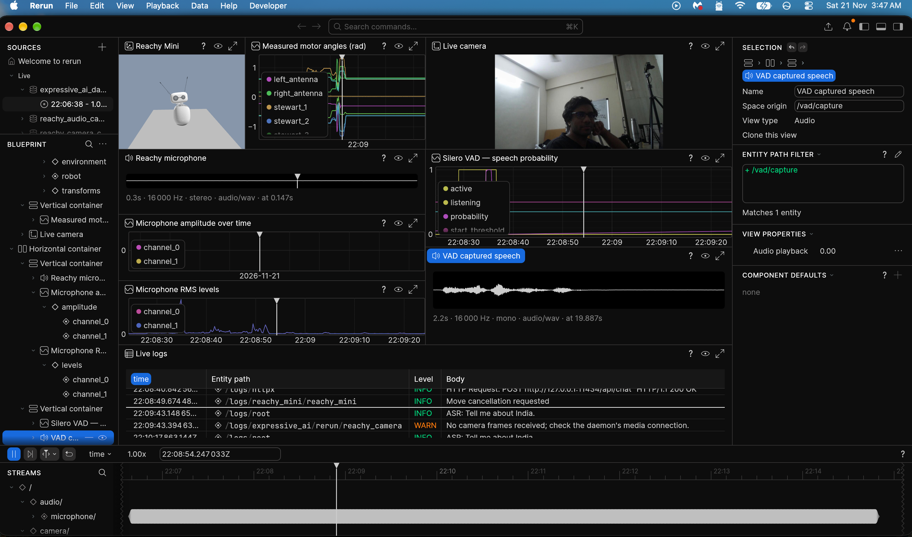

# Reachy Mini AI Assistant

Licensed under the [Apache License 2.0](LICENSE). Bundled Reachy Mini assets retain
their [upstream license and attribution](src/expressive_ai/assets/reachy_mini/NOTICE.md).

Prequisites:-
- Minimum Python 3.12
- Ollama with gemma e4b downloaded
- uv downloaded and installed - https://docs.astral.sh/uv/
- This project will also download other Deep learning models like kokoro 82M, silero-vad
- Project is dependent on MPS, will be updated later to work with CUDA, etc.
- Teleop with nintendo pro controller for rerun_motor_logs_live.py (Optional)

This project demos an e2e pipeline of Vision + Speech + Language + Motor Control over the Reachy Mini.

Running the below will start the pipeline which you can view in Rerun.

```sh
uv run expressive-ai
```

The live Rerun dashboard:



This project also contains some rerun components which can be run from rerun directory.
The controller.py script works in union with rerun_motor_logs_live.py to gain interactive motor control via a nintendo pro controller.

